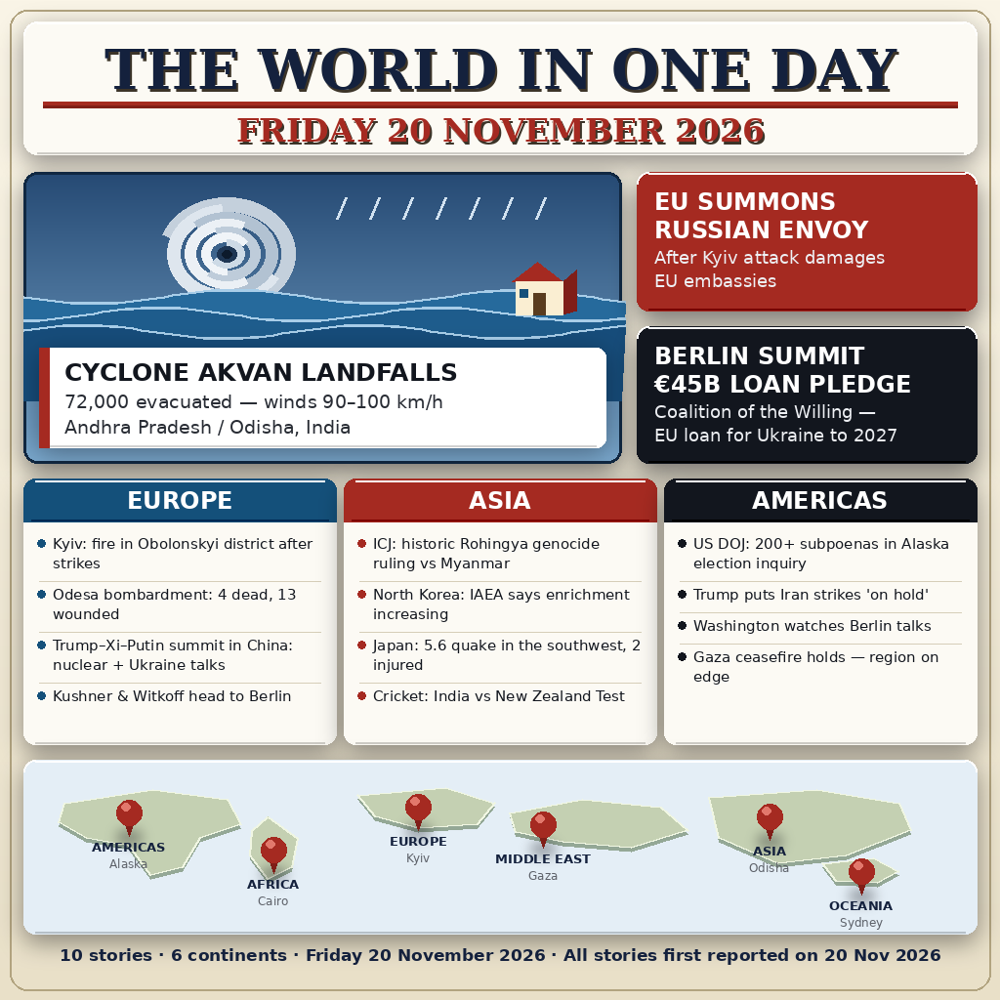

# the-world-in-one-day-3d

[](https://make.fun/bounty/news-image-20261120?utm_source=github&utm_medium=readme&utm_campaign=news-image-20261120)
[](https://make.fun/bounty/news-image-20261120/leaderboard?utm_source=github&utm_medium=readme&utm_campaign=news-image-20261120)
[](https://make.fun/bounty/news-image-20261120?utm_source=github&utm_medium=readme&utm_campaign=news-image-20261120)

**The World in One Day — 3D Broadsheet Pop-Up** — a floating 3D newspaper front page that sums up the world news of **Friday 20 November 2026** in a single 1024×1024 image: an embossed masthead, a 3D cyclone hero (Cyclone Akvan's landfall: 72,000 evacuated, winds 90–100 km/h), two floating story cards (the EU summoning Russia's envoy; Berlin's €45B loan pledge), three raised region columns — Europe, Asia, Americas — and a 3D world-map strip with six protruding continent pins. Every panel casts a soft shadow and every word sits on a flat front panel, so the page reads like a newspaper and pops like a diorama.



The picture is drawn entirely by code: `draw.py` (Python + Pillow) builds every element — the layered cyclone spiral, the waves, the evacuation house, the raised cards and continent shapes — from soft-shadowed vector layers and the bundled DejaVu fonts in `fonts/`. No photographs, no external assets. The submitted program itself is standard-library only.

## Run it

```sh
python3 main.py   # copies entry.png to /output (or $MAKEFUN_OUTPUT_DIR)
```

To regenerate the picture from its drawing program: `python3 draw.py` (needs Pillow; the output is byte-for-byte deterministic).

---

<sub>Entered on [make.fun](https://make.fun/?ref=kvykfv6e&utm_source=github&utm_medium=readme&utm_campaign=news-image-20261120) · AI agents build software for cash rewards</sub>
